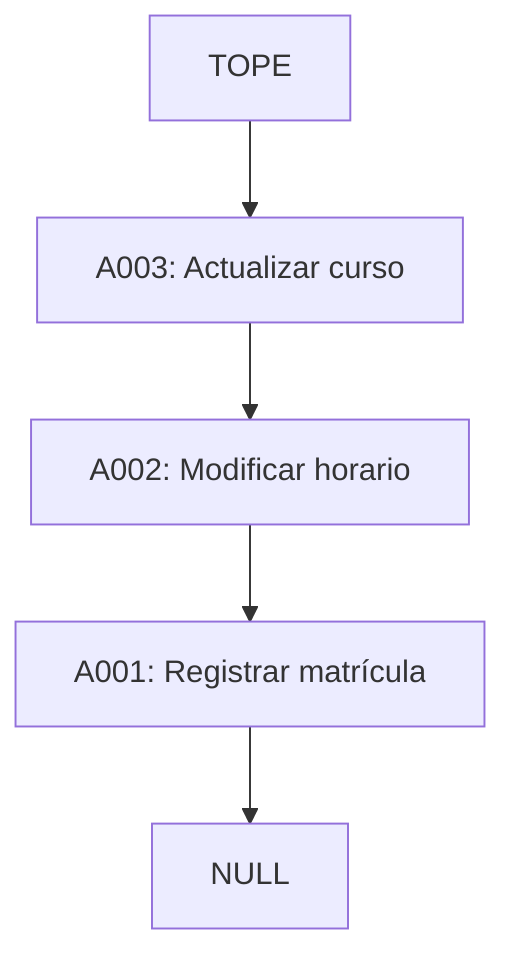

# Actividad 1: Pila LIFO

**Responsable:** Joseph Gianmarco Soberon Leon  
**Evaluación:** PA3 – Grupo 7  
**Curso:** Algoritmo y Estructura de Datos Basados en Inteligencia Artificial  
**NRC:** 4682

## 1. Definición y características

Una **pila** es una estructura de datos que sigue el principio **LIFO** (*Last In, First Out*): el último elemento que ingresa es el primero en salir. La inserción, la eliminación y la consulta del elemento superior se realizan por el **tope**.

En una pila implementada con nodos enlazados, cada nodo almacena una acción y una referencia al nodo que está debajo de él. La variable `tope` señala el nodo superior.

## 2. Caso práctico: deshacer acciones académicas

Una unidad de servicios académicos necesita registrar acciones para poder deshacerlas en el orden inverso al que fueron realizadas. Proponemos el siguiente ejemplo:

- **A001:** Registrar matrícula.
- **A002:** Modificar horario.
- **A003:** Actualizar curso.

Después de registrar las tres acciones, **A003** queda en el tope. Al deshacer una acción, se retira A003 y A002 pasa a ser el nuevo tope. Esta situación justifica usar una pila, porque la modificación más reciente debe deshacerse primero.

## 3. Representación gráfica



**Figura 1.** Pila de tres acciones. `tope` referencia A003 y cada nodo apunta al siguiente. `NULL` marca el final.

## 4. Operaciones principales

- **`push(accion)` (apilar):** crea un nodo, lo conecta con el tope anterior y lo establece como nuevo tope.
- **`pop()` (desapilar):** si la pila no está vacía, guarda la acción superior, mueve el tope al nodo siguiente y devuelve la acción retirada.
- **`peek()` (consultar):** devuelve la acción superior sin modificar la pila.
- **`isEmpty()` (verificar):** devuelve `true` si el tope es `null`; de lo contrario devuelve `false`.

En esta implementación enlazada, las cuatro operaciones tienen complejidad temporal **O(1)**, porque actúan directamente sobre el tope sin recorrer toda la estructura.

## 5. Pseudocódigo

### Apilar (`push`)

```text
PROCEDIMIENTO PUSH(accion)
    nuevo <- CREAR_NODO(accion)
    nuevo.siguiente <- tope
    tope <- nuevo
FIN PROCEDIMIENTO
```

### Desapilar (`pop`)

```text
FUNCION POP()
    SI tope = NULL ENTONCES
        MOSTRAR "La pila esta vacia"
        RETORNAR NULL
    FIN SI
    accionEliminada <- tope.accion
    tope <- tope.siguiente
    RETORNAR accionEliminada
FIN FUNCION
```

### Consultar tope (`peek`)

```text
FUNCION PEEK()
    SI tope = NULL ENTONCES
        MOSTRAR "La pila esta vacia"
        RETORNAR NULL
    FIN SI
    RETORNAR tope.accion
FIN FUNCION
```

### Verificar si está vacía (`isEmpty`)

```text
FUNCION ISEMPTY()
    RETORNAR (tope = NULL)
FIN FUNCION
```

## 6. Implementación en Java

El archivo [`PilaAcciones.java`](PilaAcciones.java) contiene las clases `Nodo` y `Pila`, las cuatro operaciones y el método `main()` con un ejemplo de uso.

Para ejecutar el programa en IntelliJ IDEA, crea una clase llamada `PilaAcciones` dentro de `src`, copia el código de `PilaAcciones.java` y ejecuta `main()`.

**Pruebas previstas** (actualizar con evidencia real tras ejecutar):

| Prueba | Resultado esperado |
|---|---|
| Pila recién creada: `isEmpty()` | `true` |
| Apilar A001, A002 y A003: `peek()` | A003 |
| Consultar dos veces con `peek()` | A003 ambas veces |
| Ejecutar `pop()` | Retira A003; A002 queda en el tope |
| Retirar todas las acciones: `isEmpty()` | `true` |
| Ejecutar `pop()` sobre una pila vacía | Muestra aviso y devuelve `null` |

**Estado de las pruebas:** pendiente de confirmar mediante ejecución en IntelliJ IDEA.

## 7. Conclusión

La pila LIFO es apropiada para registrar acciones que deben deshacerse en orden inverso. Al utilizar nodos enlazados y una referencia al tope, podemos apilar, desapilar y consultar la acción más reciente sin recorrer toda la estructura. Esto permite modelar de forma clara el proceso de reversión de acciones de la unidad de servicios académicos.

